<div align="center">

```bash
gabin@github ~ $ whoami
> Gabin Flotat — Engineering Student • Full-Stack & Systems Developer • AI & Cybersecurity Enthusiast
```

<p align="center">
  
  
</p>

<p align="center">
  
</p>

```bash
gabin@github ~ $ ./stack.sh --list
├── Languages    : Python, TypeScript, C, Java, JavaScript, SQL, PHP, HTML, CSS
├── Frameworks   : React, Tailwind CSS
├── Hardware/IoT : ESP32, LoRaWAN, FPGA, Arduino, Raspberry Pi
└── Tools        : Git, Linux, Shell
```

<p align="center">
  <a href="https://www.linkedin.com/in/gabin-flotat/" target="_blank">
    
  </a>
  &nbsp;
  <a href="https://github.com/Gab1-Flt" target="_blank">
    
  </a>
</p>

</div>
